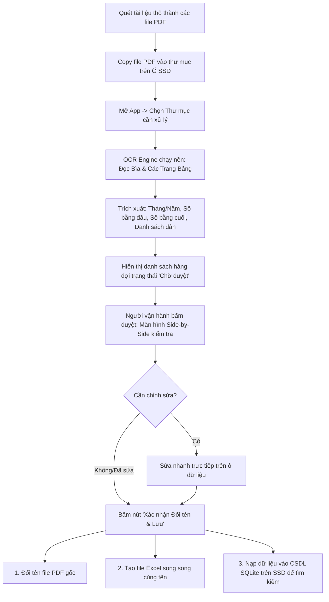
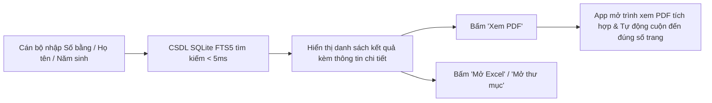

# TÀI LIỆU YÊU CẦU SẢN PHẨM (PRD)
## HỆ THỐNG SỐ HÓA, TỰ ĐỘNG ĐỔI TÊN & TRA CỨU HỒ SƠ GIẤY PHÉP LÁI XE (GPLX)

---

## 1. TỔNG QUAN DỰ ÁN

### 1.1. Bối cảnh
Tại các Sở Giao thông Vận tải / Trung tâm Quản lý GPLX, công tác số hóa hồ sơ cấp GPLX lịch sử (đặc biệt là giai đoạn trước năm 2012) đang được triển khai với khối lượng hồ sơ lưu trữ dạng bản cứng (hộp giấy) rất lớn. 
Mỗi hộp giấy chứa nhiều cuốn **Sổ gốc cấp bằng lái xe cơ giới đường bộ** (Sổ quản lý - SQL). Khi đơn vị số hóa thực hiện scan, các tài liệu được chuyển thành các file PDF thô.

### 1.2. Vấn đề thực tế
1. **Đặt tên thủ công chậm và dễ sai sót**: Nhân viên phải mở từng file PDF scan, lật trang bìa để xem ngày tháng, lật trang đầu xem số bằng STT 1, lật trang cuối xem số bằng STT cuối, sau đó gõ tay đổi tên file theo quy chuẩn lưu trữ của ngành.
2. **Khó khăn trong tra cứu khi người dân yêu cầu**: Khi người dân hoặc cơ quan chức năng cần xác minh bằng lái xe cũ, cán bộ phải tìm thủ công qua hàng trăm file/hộp số hóa.
3. **Đặc thù tài liệu lịch sử (trước 2012)**: Bản scan tài liệu năm 1996 - 2008 gồm hỗn hợp: chữ in/đánh máy cũ (Họ tên, ngày sinh, nơi cư trú) và chữ/số viết tay (Số bằng, ngày sát hạch, chữ ký).
4. **Hạn chế kỹ thuật của người dùng**: Đơn vị vận hành không có nhân sự IT chuyên sâu, không biết cài đặt hệ quản trị CSDL (DBMS, connection string), toàn bộ dữ liệu lưu trữ trên ổ cứng di động SSD và cần cho phép nhiều máy tính trong phòng cùng khai thác tra cứu.

### 1.3. Mục tiêu sản phẩm
- **Tự động hóa 80% - 95%** khâu trích xuất thông tin bìa và danh sách bảng biểu để đổi tên file PDF chuẩn xác.
- **Tự động sinh file Excel (.xlsx) tương ứng** cùng tên với file PDF sau khi đổi tên, lưu trữ toàn bộ dữ liệu người dân trong sổ.
- **Lưu trữ CSDL 'Zero-Config'**: Tích hợp CSDL nhúng trực tiếp trên ổ SSD, cắm vào máy tính là chạy ngay, không cần cài đặt SQL Server / MySQL.
- **Tra cứu siêu tốc & Xem trực quan**: Tìm kiếm theo Tên, Số bằng lái, Năm sinh; click là nhảy thẳng đến đúng trang người dân trong file PDF.
- **Mô hình Hybrid đa máy**: Chạy độc lập trên máy cắm SSD, đồng thời có chế độ 1-click bật chia sẻ mạng LAN để các máy khác trong phòng truy cập tra cứu qua trình duyệt.

---

## 2. NGƯỜI DÙNG MỤC TIÊU (USER PERSONAS)

1. **Nhân viên Số hóa / Hậu kiểm (Operator)**:
   - *Nhiệm vụ*: Quét tài liệu, nạp thư mục file PDF scan thô vào ứng dụng, kiểm tra nhanh (review) kết quả OCR đề xuất, xác nhận đổi tên hàng loạt và xuất file Excel.
   - *Yêu cầu UX*: Giao diện trực quan, trực tiếp đối chiếu ảnh scan và bảng dữ liệu cạnh nhau (side-by-side), phím tắt nhanh, highlight các ô nghi ngờ để kiểm tra trong 2-3 giây.
2. **Cán bộ Tra cứu / Tiếp dân (Viewer/Officer)**:
   - *Nhiệm vụ*: Nhập thông tin người dân (Số bằng lái, Họ tên, Năm sinh) để kiểm tra tính hợp lệ của GPLX cũ, trích xuất thông tin hồ sơ gốc.
   - *Yêu cầu UX*: Tìm kiếm nhanh (gõ có dấu hoặc không dấu), xem ngay bản scan PDF có tích hợp thanh phóng to/thu nhỏ, in ấn hoặc mở file ngoài.

---

## 3. QUY TẮC NGHIỆP VỤ (BUSINESS RULES)

### 3.1. Quy tắc đặt tên file Sổ Quản Lý (Trước năm 2012)
Cấu trúc quy định:
```text
[Mã tỉnh].[SQL].[Tháng].[Năm].[Số bằng đầu]-[Số bằng cuối]
```

**Chi tiết các thành phần:**
- `Mã tỉnh`: Mã cấp 1 của tỉnh/thành phố theo danh mục quy định chính thức (đã nạp sẵn trong hệ thống tại [province_codes.json](file:///c:/Users/FPT%20SHOP/Desktop/v2theanh28project/data/province_codes.json), gồm 34 mã tỉnh/thành phố như: `01` - Hà Nội, `15` - Lào Cai, `31` - Hải Phòng, `79` - TP.HCM, `92` - Cần Thơ,...). Người dùng có thể chọn nhanh từ danh sách thả xuống hoặc hệ thống tự động nhận diện từ dòng *"SỞ GIAO THÔNG VẬN TẢI..."* trên trang bìa.
- `SQL`: Ký hiệu cố định của loại tài liệu **Sổ quản lý** (Sổ gốc).
- `Tháng`: 2 chữ số (từ `01` đến `12`) lấy từ Ngày thi / Ngày sát hạch trên trang bìa (Ví dụ: ngày 22-03-1996 -> Tháng `03`).
- `Năm`: 4 chữ số lấy từ Ngày thi trên trang bìa (Ví dụ: `1996`).
- `Số bằng đầu`: Số GPLX của người đầu tiên (STT 1) tại Trang danh sách số 1 (Ví dụ: `A161541` hoặc `A466375`).
- `Số bằng cuối`: Số GPLX của người cuối cùng (STT cuối) tại Trang danh sách cuối cùng của cuốn sổ (Ví dụ: `C244140` hoặc `C244132`).
- *Lưu ý*: Phân tách bằng dấu chấm `.` và dấu gạch ngang `-`, tuyệt đối không sử dụng dấu gạch chéo `/` vì hệ điều hành Windows không cho phép trong tên file.

*Ví dụ tên file hoàn chỉnh:*
- `15.SQL.03.1996.A161541-C244140.pdf`
- `15.SQL.03.1996.A161541-C244140.xlsx`

### 3.2. Cấu trúc file Excel xuất kèm (.xlsx)
Mỗi file PDF sau khi xác nhận đổi tên sẽ tự động sinh 1 file Excel nằm cùng thư mục, chứa các cột dữ liệu **bắt buộc lưu trữ Tiếng Việt có dấu đầy đủ**:
1. `STT`: Số thứ tự người dân trong sổ, đánh số tuần tự lần lượt liên tục từ `1` đến `N` xuyên suốt toàn bộ các trang trong file PDF (không bị lặp đếm lại theo từng trang)
2. `Họ và tên`: Họ tên công dân **có dấu tiếng Việt chuẩn xác** (Ví dụ: `Trần Văn Yên`, `Nguyễn Văn Thúy`, `Đỗ Vi Thượng`)
3. `Năm sinh`: 4 chữ số (Ví dụ: `1960`, `1968`)
4. `Quốc tịch`: Mặc định chuẩn hóa **`Việt Nam`** (có dấu đầy đủ)
5. `Nơi cư trú`: Địa chỉ hành chính chuẩn hóa **có dấu tiếng Việt** (Ví dụ: `H. Lục Yên, Tỉnh Yên Bái`)
6. `Số bằng`: Mã số bằng lái (chữ + số, ví dụ `A161541`)
7. `Số trang PDF`: Trang xuất hiện trong file PDF tương ứng
8. `Hạng / Khóa / Ngày thi`: Thông tin trích xuất từ bìa sổ

### 3.3. Sổ Theo Dõi, Rà Soát Dãy Số GPLX Trong Sổ Gốc (File Excel Tổng Hợp theo Tỉnh)
Ngoài file Excel con cho từng sổ, hệ thống tự động duy trì một **File Excel Tổng Hợp Cấp Tỉnh** (Ví dụ: `So_Theo_Doi_Day_So_GPLX_15.xlsx`). Mỗi khi một file PDF được duyệt hoàn thành, hệ thống sẽ tự động chèn thêm dòng mới (hoặc cập nhật đè nếu file đã tồn tại) với tiêu đề chuẩn:
`"SỔ THEO DÕI, RÀ SOÁT DÃY SỐ GPLX TRONG SỔ GỐC"`

**12 Cột dữ liệu chuẩn trong File Tổng Hợp Tỉnh:**
1. `STT`: Số thứ tự (1, 2, 3...)
2. `Loại sổ`: Trích xuất từ tiêu đề trên bìa sổ (Ví dụ: *"Sổ gốc cấp bằng lái xe cơ giới đường bộ"*, *"Sổ gốc cấp bằng mô tô hạng A1"*)
3. `Ngày tại bìa sổ`: Ngày thi trích xuất từ bìa (Ví dụ: `22/03/1996`)
4. `Tên file PDF`: Tên file chuẩn sau khi đã đổi tên (Ví dụ: `15.SQL.03.1996.A161541-C244140`)
5. `HỘP`: Số/tên Hộp hoặc Tủ hồ sơ (Trích xuất tự động từ thư mục cha cấp 2, ví dụ thư mục `HOP_48` -> `48`)
6. `HỘP SỐ`: Số/tên Hộp số hoặc Hộp giấy (Trích xuất tự động từ thư mục cha cấp 1, ví dụ thư mục `HOP_SO_115` -> `115`)
7. `Hạng`: Hạng bằng trích xuất từ bìa (Ví dụ: `A1`)
8. `Tổng số lượng GPLX`: Số lượng dòng công dân có GPLX được số hóa trong file (Ví dụ: `66`, `113`)
9. `Số GPLX trong file`: Dải số bằng lái. Nếu liên tục thì ghi dạng `A465975-A466040`; nếu bị đứt đoạn/nhảy số thì liệt kê các phân đoạn cách nhau dấu chấm phẩy (Ví dụ: `A161541; C244138-C244248; C244253-C244256`)
10. `Tổng số trang PDF`: Tổng số trang của file PDF tương ứng
11. `Ghi chú / nhận định`: Tự động đánh giá: ghi `"Đủ"` nếu dãy số liên tục tăng dần; ghi `"Ngắt, không theo thứ tự"` nếu dãy số bị ngắt quãng hoặc không tuần tự
12. `Ngày cập nhật`: Ngày giờ ghi nhận bản ghi (Ví dụ: `2026-11-19 09:58`)

### 3.4. Cấu trúc thư mục lưu trữ 3 cấp
Dữ liệu đầu vào và lưu trữ trên ổ SSD được tổ chức phân cấp:
```text
[Tỉnh]  (Ví dụ: LaoCai)
  └── [HỘP - Tủ hồ sơ]  (Ví dụ: HOP_48)
        └── [HỘP SỐ - Hộp giấy]  (Ví dụ: HOP_SO_115)
              └── [Hồ sơ]  (File PDF số hóa: scan_001.pdf -> 15.SQL.03.1996.A161541-C244140.pdf)
```

---

## 4. QUY TRÌNH NGHIỆP VỤ (WORKFLOW)

### 4.1. Luồng Số hóa, OCR & Hậu kiểm (Batch Ingestion Pipeline)


### 4.2. Luồng Tra cứu & Mở hồ sơ (Search & View Flow)


---

## 5. CÁC TÍNH NĂNG CHI TIẾT (FUNCTIONAL REQUIREMENTS)

### 5.1. Phân hệ Xử lý Hồ sơ & OCR (Module Ingestion)
- **F-101 (Chọn thư mục/tập tin)**: Cho phép chọn 1 thư mục chứa hàng loạt file PDF hoặc kéo thả từng file.
- **F-102 (Hàng đợi xử lý Batch Queue)**: Hiển thị danh sách các file đang chờ xử lý, tiến độ OCR (% trang), trạng thái: `Đang xử lý`, `Chờ duyệt`, `Hoàn thành`, `Lỗi`.
- **F-103 (Trích xuất Bìa sổ)**: Tự động nhận diện Tỉnh, Khóa thi, Hạng GPLX, Ngày/Tháng/Năm thi.
- **F-104 (Nhận dạng Bảng biểu & Chữ viết tay)**: 
  - Phân vùng cấu trúc bảng (Table Detection & Cell Segmentation).
  - OCR nhận dạng chữ in (Họ tên, Ngày sinh, Địa chỉ) với bộ gõ tiếng Việt.
  - Phân loại và nhận dạng ký tự viết tay / in kim ở cột `Số bằng` (regex pattern: 1-2 chữ cái + 6 số).
- **F-105 (Gợi ý tên file chuẩn)**: Tự động ghép chuỗi quy tắc `MãTỉnh.SQL.Tháng.Năm.SốĐầu-SốCuối`.
- **F-106 (Màn hình Đối soát Hậu kiểm Side-by-side)**:
  - Cửa sổ bên trái: Bản xem trước PDF (cho phép zoom, xoay trang).
  - Cửa sổ bên phải: Form thông tin bìa + Bảng danh sách người dân dạng editable grid.
  - Tự động highlight màu vàng/đỏ các ô có độ tin cậy OCR thấp để nhân viên chú ý kiểm tra.
- **F-107 (Xác nhận & Xuất dữ liệu In-Place 1-Click)**:
  - **Lưu trực tiếp vào đúng thư mục tải lên**: File PDF mới đổi tên và file Excel con được tạo ngay tại thư mục chứa file scan gốc (ví dụ: `[Tỉnh]/[Hộp]/[Hộp số]/`).
  - **Bảo toàn 100% dữ liệu gốc**: Tuyệt đối **không thay đổi hoặc xóa các file scan cũ**.
  - **Cập nhật Sổ theo dõi tỉnh**: Tự động tìm ngược lên thư mục Tỉnh để cập nhật hoặc tạo mới file tổng hợp `So_Theo_Doi_Day_So_GPLX_[MãTỉnh].xlsx`.
  - Ghi bản ghi vào CSDL SQLite nội bộ.
- **F-108 (Tự động Cập nhật Sổ Theo Dõi Tổng Hợp Tỉnh)**:
  - Tự động bóc tách thông tin HỘP và HỘP SỐ từ cấu trúc thư mục 3 cấp.
  - Thuật toán tự động rà soát dải số GPLX và đánh giá tính liên tục ("Đủ" vs "Ngắt, không theo thứ tự").
  - Tự động cập nhật nối tiếp dòng mới vào File Excel Tổng Hợp Tỉnh (`So_Theo_Doi_Day_So_GPLX_[MãTỉnh].xlsx`) với đầy đủ 12 cột.
- **F-109 (Trải nghiệm Người dùng & Kiểm soát Trạng thái Nút bấm)**:
  - **Mặc định toàn màn hình (Maximized Full Screen)**: Mở ứng dụng chiếm trọn màn hình máy tính ngay khi khởi chạy.
  - **Giao diện Kéo giãn Đa năng (Resizable 3-Column Splitters)**: 
    - Cho phép người dùng kéo thả vạch ngăn (sash) sang trái/phải để tùy chỉnh độ rộng giữa 3 cột: *Hàng đợi hồ sơ*, *Trình xem PDF* và *Màn hình đối soát*.
  - **Cuộn 2 Chiều trong Trình xem PDF (Bidirectional Scrolling)**:
    - Trang bị đầy đủ cả **Thanh cuộn ngang (Horizontal scrollbar)** và **Thanh cuộn dọc (Vertical scrollbar)**.
    - Hỗ trợ cuộn ngang linh hoạt bằng phím tắt `Shift + Lăn chuột` hoặc kéo thanh trượt, tối ưu cho các bản scan sổ khổ ngang (Landscape).
  - **Icon Loading Vòng tròn Chạy Động (Animated Circular Spinner)**:
    - Khi đang chạy OCR, nút bấm hiển thị biểu tượng xoay vòng tròn chuyển động liên tục (`⠋ ⠙ ⠹... Đang Chạy OCR...`) báo hiệu tiến trình đang hoạt động.
  - **Làm mờ / Khóa nút thông minh**:
    - Nút *'Chạy OCR Tự Động'* bị disable (làm mờ) khi chưa có file nào được nạp vào hàng đợi; chỉ kích hoạt khi đã chọn thư mục hoặc file.
    - Nút *'Xác nhận: Đổi tên PDF & Xuất Excel...'* bị disable (làm mờ) trong suốt quá trình chưa chạy OCR xong; chỉ kích hoạt khi dữ liệu đã sẵn sàng để đối soát.
  - **Điểm nhấn trực quan**: Nút *'Chọn File PDF lẻ'* được thiết kế màu xanh ngọc lục bảo nổi bật (`#10B981`) để người dùng dễ nhận biết.
- **F-110 (Đổi tên file theo folder với Thuật toán Fast OCR Tối ưu)**:
  - Bổ sung nút **'📑 Đổi tên file (theo folder)'** trong khung Hàng đợi hồ sơ.
  - Cho phép chọn 1 thư mục chứa nhiều file PDF scan thô; hệ thống tự động quét và đổi tên hàng loạt.
  - **Thuật toán Fast OCR siêu tốc**: Chỉ đọc tối đa 3 trang (Trang 1: Bìa lấy Mã tỉnh/Tháng/Năm; Trang 2: Hàng 1 lấy Số bằng đầu; Trang cuối: Hàng cuối lấy Số bằng cuối). Bỏ qua 100% các trang ở giữa, giúp giảm 90% thời gian xử lý và tải CPU.
  - Có cơ chế quét dòng kế cận nếu ô đầu/cuối bị mờ.
  - Tự động copy ra file PDF mới có tên chuẩn `[Mã tỉnh].[SQL].[Tháng].[Năm].[Số đầu]-[Số cuối].pdf` ngay tại thư mục đó.
  - Đảm bảo giữ nguyên 100% file gốc cũ, không xóa file cũ, không tạo file excel con (chỉ tập trung sao chép và đổi tên chuẩn).

### 5.2. Phân hệ Tra cứu & Khai thác (Module Search & Discovery)
- **F-201 (Ô tìm kiếm đa năng)**: Tìm kiếm tức thì theo:
  - Số bằng lái xe (tìm chính xác hoặc theo tiền tố/hậu tố).
  - Họ và tên người dân (hỗ trợ tìm không dấu, ví dụ gõ `tran van yen` ra `Trần Văn Yên`).
  - Năm sinh, Địa chỉ cư trú.
  - Lọc theo năm cấp, khóa thi, tỉnh.
- **F-202 (Danh sách kết quả)**: Hiển thị dạng bảng trực quan: STT, Họ tên, Năm sinh, Số bằng, Tên file PDF, Vị trí trang.
- **F-203 (Trình đọc PDF tích hợp - Built-in Viewer)**:
  - Nhấp vào người dân -> Mở ngay cửa sổ xem PDF nội bộ.
  - **Tự động chuyển đến đúng trang** mà người dân đó có tên.
  - Hỗ trợ công cụ: Phóng to, thu nhỏ, xoay trang, in trang hiện tại.
- **F-204 (Tương tác tệp hệ thống)**:
  - Nút `Mở bằng phần mềm ngoài` (Foxit Reader, Adobe Acrobat...).
  - Nút `Mở file Excel tương ứng`.
  - Nút `Mở thư mục chứa file` trong Windows Explorer.
- **F-205 (Theo dõi Danh mục Sổ / File Excel / Hộp / Tỉnh Đã Import)**:
  - Trang bị 2 chế độ xem trực tiếp trên màn Tra cứu: **`👤 Tra Cứu Công Dân`** và **`📁 Danh Mục Sổ / File Excel Đã Import`**.
  - Liệt kê đầy đủ các cuốn sổ đã import vào CSDL: Mã tỉnh, Tên tỉnh, HỘP, HỘP SỐ, Tên file PDF, Tên file Excel, Hạng, Khóa, Ngày bìa, Tổng số lượng GPLX, Ngày import.
  - Cho phép người dùng biết chính xác những file Excel/PDF nào, hộp nào, tỉnh nào đã được đưa vào hệ thống.
  - Hỗ trợ bấm `👥 Xem toàn bộ công dân trong sổ` để tự động chuyển sang chế độ tra cứu và lọc đúng danh sách người lái xe trong cuốn sổ đó.

### 5.3. Phân hệ Quản trị & Chia sẻ Mạng LAN (Module Administration & LAN Sharing)
- **F-301 (Zero-Config Portable)**: Toàn bộ cấu hình và file CSDL `gplx_index.db` nằm ngay trong thư mục `HeThong/` trên ổ SSD. Không yêu cầu cấu hình cổng kết nối, mật khẩu CSDL phức tạp.
- **F-302 (Bật/Tắt chia sẻ Mạng LAN - 1-Click LAN Server)**:
  - Trên máy tính cắm ổ SSD (máy chủ), có giao diện quản trị Tab `🌐 Chia Sẻ Mạng LAN`:
    - Nút bấm `Bật / Tắt chia sẻ mạng LAN`.
    - Tự động phát hiện IP máy chính (Ví dụ: `192.168.1.15:8080`), hỗ trợ tùy biến cổng (Port).
    - Hiển thị mã QR Code tự động sinh để nhân viên khác dùng điện thoại / tablet hoặc laptop phụ quét kết nối ngay lập tức.
    - Nút bấm `📋 Sao chép địa chỉ` và `🌐 Mở trên Trình duyệt`.
- **F-303 (Phân hệ Web Client Mạng LAN dành cho Máy phụ)**:
  - Chạy trực tiếp trên trình duyệt Google Chrome, Microsoft Edge mà không cần cài đặt bất kỳ phần mềm nào trên máy phụ.
  - Thiết kế thuần CSS/JS hoạt động 100% offline, không cần internet.
  - Ô tìm kiếm thông minh tự động lọc tức thì theo Họ tên, Số bằng, Năm sinh; bộ lọc theo Tỉnh.
  - Bảng kết quả trực quan, tích hợp **Trình xem PDF nhúng (Modal Viewer)** tự động mở và nhảy đến chính xác trang của công dân (`#page=X`).
  - Nút tải trực tiếp file Excel con tương ứng về máy phụ qua mạng nội bộ.
- **F-304 (Sao lưu & Đồng bộ)**:
  - Chức năng `Quét lại dữ liệu từ Excel` (Re-index): Nếu người dùng chỉnh sửa trực tiếp file Excel bằng Microsoft Excel ngoài desktop, bấm nút này hệ thống sẽ tự động cập nhật lại vào CSDL SQLite.

---

## 6. YÊU CẦU PHI CHỨC NĂNG (NON-FUNCTIONAL REQUIREMENTS)

1. **Hiệu năng & Tốc độ**:
   - Tốc độ tìm kiếm: Dưới 50ms cho kho dữ liệu 500,000 người dân nhờ công nghệ SQLite FTS5 (Full-Text Search).
   - Tốc độ OCR trên máy tính văn phòng (Core i5, RAM 8GB, CPU only): Trung bình 1.5 - 2.5 giây/trang.
2. **Khả năng tương thích**:
   - Hệ điều hành: Windows 10, Windows 11 (64-bit).
   - Không phụ thuộc vào internet: Hoạt động 100% offline, bảo mật dữ liệu tuyệt đối.
3. **Độ tin cậy & An toàn dữ liệu**:
   - Khi đổi tên file: Thực hiện cơ chế atomic/safe-rename, không bao giờ làm mất file gốc nếu xảy ra lỗi ghi đĩa.
   - Luôn giữ file Excel độc lập bên cạnh file PDF: Ngay cả khi phần mềm bị xóa, người dùng vẫn còn nguyên toàn bộ file PDF chuẩn và file Excel để mở bằng Microsoft Office.
